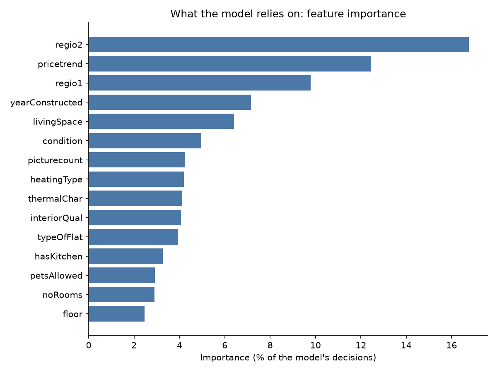

# 🏠 Predicting the Rent Class of German Flats

A classification study on **268,850 rental listings** from ImmoScout24: can we tell whether a flat is **cheap, fair or expensive per m²** from its features alone, without seeing its price?

| | |
|---|---|
| **Target** | `rentClass`: Low (< €6.07/m²), Medium (€6.07–9.06), High (> €9.06), three equal-sized groups |
| **Best model** | Random Forest (100 trees) |
| **Test accuracy** | **80.3 %** (goal ≥ 70 %, baseline 33.4 %) |
| **Dangerous mistakes** | Low ↔ High confusions on only **0.47 %** of flats |
| **Method** | CRISP-DM, from business understanding to evaluation |

📄 **Full report:** [reports/final_report.md](reports/final_report.md) (also as [Word](reports/final_report.docx))

---

## Why this matters
Rents in Germany range from about €2 to €40 per m², and tenants struggle to judge whether a listing is fair. The model predicts what a flat **should** cost based on its features. A rental platform can compare that with the actual asking price:

| Features say… | Actual price is… | Label |
|---|---|---|
| Expensive | Cheap | 💎 Possible good deal |
| Cheap | Expensive | ⚠️ Possibly overpriced |

---

## Key findings
- **Location dominates.** District, area price trend and state drive ~39 % of the model's decisions. Hamburg (94 % High) and Berlin (86 %) are the most expensive; Saxony-Anhalt (3 %) and Thuringia (5 %) the cheapest.
- **Newer is pricier.** A typical High-rent flat was built around 1997, a Low-rent flat around 1965. New builds are more often High in **all 16 states**.
- **Size has a U-shaped effect.** Very small (< 40 m²) and large (100 m²+) flats are the most expensive per m²; mid-size flats are cheapest.
- **Garden and cellar barely matter**; the effect of a garden even flips depending on the region.
- **Most mistakes are borderline cases:** 73 % of wrong predictions are within €1/m² of a class border.



---

## Model comparison (validation set)

| Model | Validation accuracy |
|---|---|
| **Random Forest** | **79.4 %** (5-fold CV: 79.6 % ± 0.2) |
| Bagging | 78.3 % |
| Logistic Regression | 74.1 % |
| Voting (LogReg + Tree + Naive Bayes) | 74.0 % |
| Decision Tree (depth 20) | 72.4 % |
| k-NN (k = 15) | 70.2 % |
| Naive Bayes | 62.3 % |
| Baseline (always one class) | 33.4 % |

---

## Project structure

```
├── notebooks/
│   ├── 01_data_preparation.ipynb   Phases 1–5: business understanding, data quality, cleaning, target
│   ├── 02_eda.ipynb                Phase 6: exploratory analysis and statistical tests
│   ├── 03_modeling.ipynb           Phases 7–8: pipeline, 7 models, cross-validation, tuning
│   └── 04_evaluation.ipynb         Phase 9: final test, confusion matrix, feature importance, errors
├── reports/
│   ├── final_report.md / .docx     Full written report
│   └── figures/                    Charts used in the report
├── doc/
│   └── tuning_guide.md             Reference: how to tune each classifier
├── data/
│   ├── raw/                        immo_data.csv goes here (not in Git)
│   └── processed/                  Created by notebook 01 (not in Git)
├── models/                         Created by notebook 03 (not in Git)
├── PROJECT_ROADMAP.md              Step-by-step plan with results
└── requirements.txt
```

The notebooks hand off through saved files, so each one runs on its own:
`01` → `data/processed/immo_clean.csv` → `02`, `03` → `models/*.joblib` → `04`

---

## How to run

**Requirements:** Python 3.14 (tested with 3.14.2)

```bash
# 1. Create and activate a virtual environment
python -m venv .venv
.venv\Scripts\activate            # Windows
# source .venv/bin/activate       # macOS / Linux

# 2. Install the packages
pip install -r requirements.txt
```

3. **Get the data:** download `immo_data.csv` from Kaggle ([Apartment rental offers in Germany](https://www.kaggle.com/datasets/corrieaar/apartment-rental-offers-in-germany)) and place it in `data/raw/`.
4. **Run the notebooks in order:** `01` → `02` → `03` → `04`.
   - Notebook 03 trains several Random Forests and runs cross-validation; expect roughly 30–60 minutes in total.

All random steps use `random_state=42`, so the results are reproducible.

---

## Tools
pandas · NumPy · scikit-learn · SciPy · Matplotlib · seaborn · Jupyter · joblib
