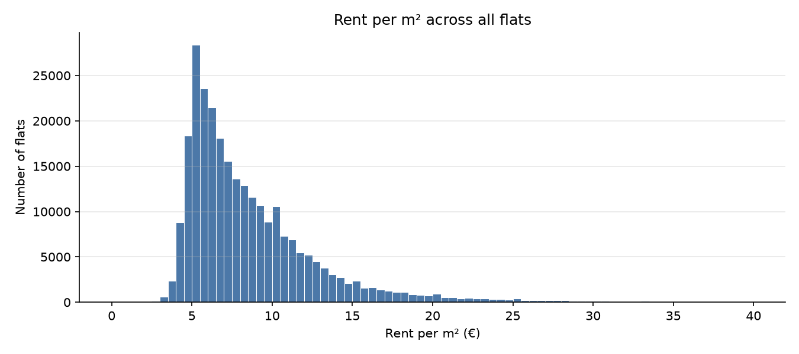
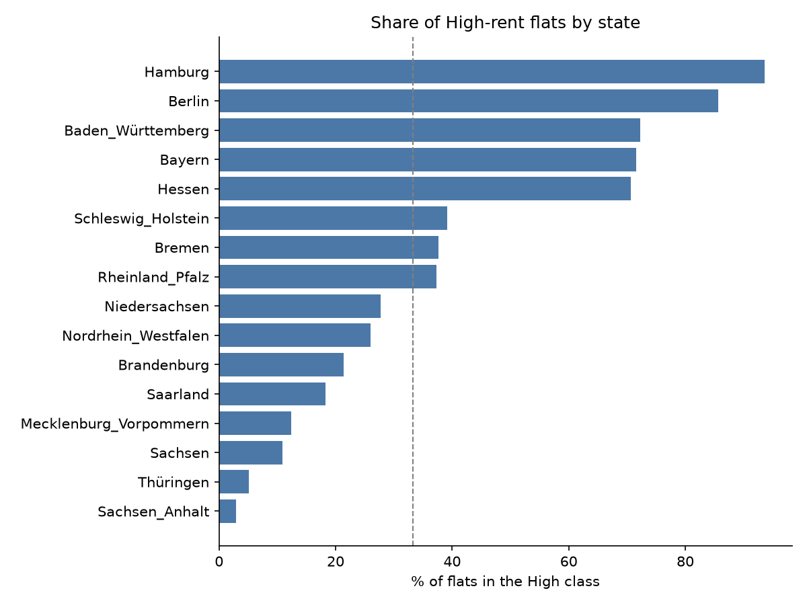
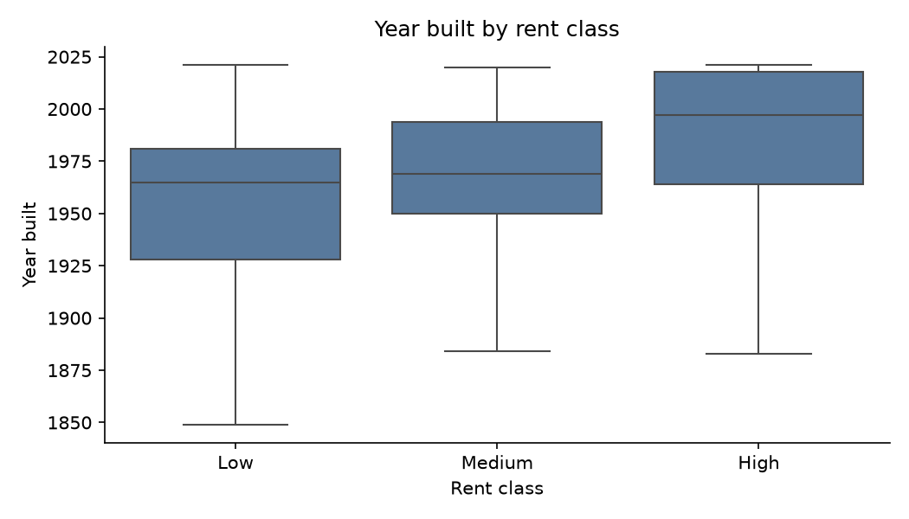
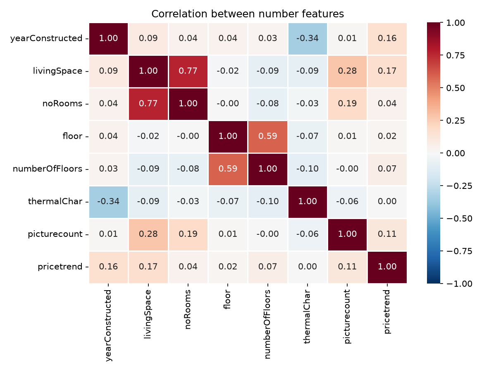
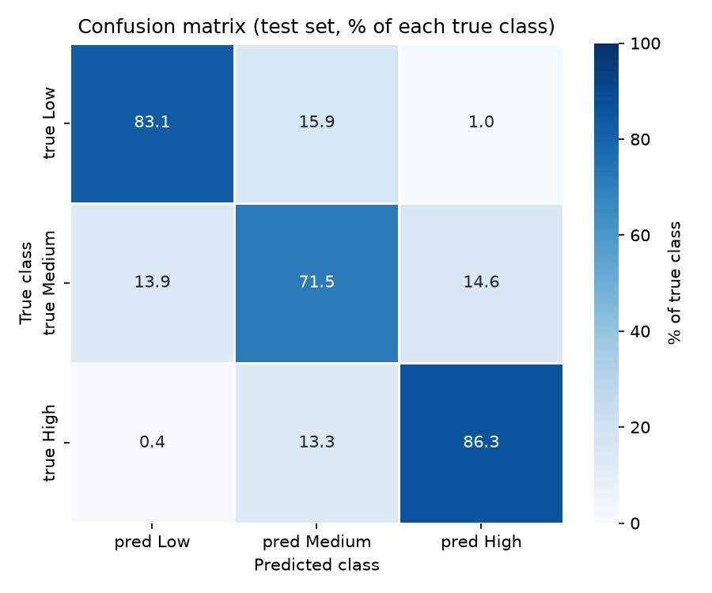
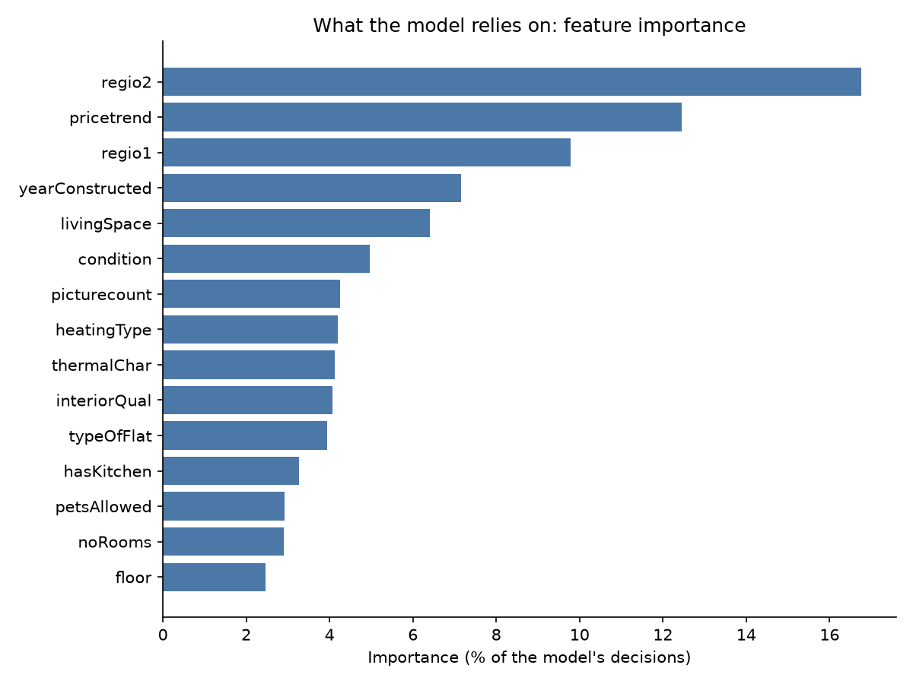

# Predicting the Rent Class of German Flats

**A classification study on 268,850 ImmoScout24 rental listings**

| | |
|---|---|
| **Task** | Multi-class classification (Low / Medium / High rent per m²) |
| **Method** | CRISP-DM |
| **Final model** | Random Forest (100 trees) |
| **Result** | **80.3 % test accuracy** (goal ≥ 70 %); far mistakes (Low ↔ High) only 0.47 % |
| **Code** | `notebooks/01_data_preparation.ipynb` → `02_eda.ipynb` → `03_modeling.ipynb` → `04_evaluation.ipynb` |

---

## Summary

Rents in Germany range from about €2 to €40 per m², and it is hard for tenants to judge whether a listing is cheap, fair or expensive for what it offers. This study builds a model that predicts a flat's **rent class per m²** (Low < €6.07, Medium €6.07–9.06, High > €9.06) from its features alone, **without seeing its price**. A rental platform can compare this prediction with the actual asking price to flag listings as *possibly overpriced* or *possible good deals*.

After cleaning 268,850 listings to 267,855 and reducing 49 columns to 23 features, seven classifiers were compared. A **Random Forest** performed best and reached **80.3 % accuracy on an untouched test set**, well above the 33.4 % baseline and the 70 % goal. Almost all mistakes are between neighbouring classes, mostly for flats priced close to a class border; the dangerous **Low ↔ High** mistakes affect only **0.47 %** of flats.

The strongest driver of rent class is **location** (district, area price trend and state: about 39 % of the model's decisions), followed by **year of construction** and **living space**, which has a U-shaped effect: very small and very large flats are the most expensive per m².

---

## 1. Business understanding

### 1.1 Background and problem
Rent levels vary widely between regions, cities and types of property. A tenant browsing hundreds of listings cannot easily tell whether a specific offer is cheap, fair or expensive **for what it offers**, and a platform has no automatic way to tell them.

### 1.2 User and decision
- **Main user:** a rental platform such as ImmoScout24, and through it, its tenants.
- **What the model does:** predicts the **expected** rent class of a flat from its attributes (location, size, age, condition, equipment), without seeing its price.
- **Decision it supports:** the platform compares the predicted class with the actual price:

| Predicted vs actual | Platform label |
|---|---|
| Predicted Medium, actually High | ⚠️ Possibly overpriced |
| Predicted High, actually Medium | 💎 Possible good deal |

- **Secondary goal:** find which attributes drive a flat into a higher price class.

### 1.3 Target definition
- **Target:** `rentClass` ∈ {Low, Medium, High}, built from `rentPerSqm = baseRent ÷ livingSpace`.
- **Why per m² and not total rent?** Total rent mainly reflects size. Per m² removes the size effect and shows the price **level**:

| Flat | Size | Total rent | Rent per m² |
|---|---|---|---|
| A | 30 m² | €600 | €20 (expensive) |
| B | 120 m² | €1,200 | €10 (cheaper) |

- **How the classes are made:** all flats are sorted by rent per m² and cut into **three equal-sized groups** (tertiles).

### 1.4 Success criteria (set before looking at the data)
| Criterion | Target |
|---|---|
| Beat the baseline (always guessing one class) | > ~33 % |
| **Main goal: accuracy** | **≥ 70 %** |
| Mistake priority | **Far mistakes (Low ↔ High) must be rare**: classes are ordered, and a far mistake would mislead tenants |
| Reporting | Per-class precision, recall, F1 and the confusion matrix |

Accuracy is a valid main measure only if the classes are balanced and mistakes cost about the same. Balance is guaranteed by the tertile split; the unequal cost of far mistakes is handled with the confusion-matrix check.

---

## 2. Data understanding

### 2.1 The dataset
- **Source:** `immo_data.csv`, German rental listings scraped from ImmoScout24 (2018–2020).
- **Size:** **268,850 listings × 49 columns** (≈ 90 MB in memory): 18 decimal, 6 whole-number, 6 yes/no and 19 text columns.
- **Target ingredients:** `baseRent` and `livingSpace` have **no missing values**, so every row can receive a target.

### 2.2 Column types
A data dictionary (type, % missing, number of unique values, example) was built for every column, and each column was classified:

| Group | Count | Examples |
|---|---|---|
| Numeric | 17 | `livingSpace`, `yearConstructed`, `noRooms` |
| Categorical (text) | 13 | `regio1`, `heatingType`, `condition`, `interiorQual` |
| Categorical (stored as a number code) | 5 | `geo_plz`, `baseRentRange`, `livingSpaceRange` |
| Boolean | 6 | `balcony`, `lift`, `hasKitchen` |
| Free text | 2 | `description`, `facilities` |
| ID / address | 4 | `scoutId`, `street`, `houseNumber` |
| Date | 1 | `date` (only 4 values: the scraping month) |
| Constant | 1 | `telekomHybridUploadSpeed` |

### 2.3 Duplicates and redundancy
- **0 duplicated rows and 0 duplicated listing IDs.**
- **Identical pairs:** `regio1` = `geo_bln` (state) and `regio2` = `geo_krs` (district) match in 100 % of rows, so only one of each is needed.

### 2.4 Leakage check
**Leakage** means an input column contains the answer. The test used: *"Could I know this value without knowing the flat's rent?"*

| Column | Reason it must not be an input |
|---|---|
| `baseRent` | It is the rent |
| `totalRent` | Rent + extra costs |
| `baseRentRange` | The rent grouped into bands (verified: its min–max ranges never overlap) |
| `serviceCharge`, `heatingCosts` | Price information set together with the rent |

---

## 3. Data quality assessment

### 3.1 Missing values
27 of 49 columns have missing values, from 0.7 % (`pricetrend`) to 83 % (`telekomHybridUploadSpeed`). Each column received a decision based on **why** values are missing:

| Decision | When | Columns |
|---|---|---|
| **Drop** | Mostly empty (> 60 %), or removed anyway (leakage, IDs, text, not about the flat) | 15 |
| **Yes/no flag** | The gap itself carries meaning | `lastRefurbish` → `wasRefurbished`, `noParkSpaces` → `hasParking` |
| **"unknown"** | Categories, because a missing value may itself be a clue | 5 (`interiorQual`, `condition`…) |
| **Median / model-based** | Numbers with moderate gaps | 5 (`yearConstructed`, `floor`…) |

Assumptions were checked with data. For example, `noParkSpaces` contains both empty cells **and** zeros (3,855 flats), so an empty cell means "not stated", not "no parking", and the flag was defined as "at least one space advertised".

### 3.2 Impossible values
Summary statistics revealed clear errors: rent of €0 and €9,999,999; living space of 0 m² and 111,111 m²; 1,000 rooms; construction years 1000 and 2090; floor 999. Repeated digits (999, 111,111, 9,999,999) are typical "unknown" placeholders. A cross-column check found 1,411 flats on a higher floor than their building has.

### 3.3 Outliers
The IQR rule flagged many **real** flats as outliers (expensive city flats, ordinary 5-room flats, historic buildings). **Decision: keep outliers** and remove only impossible values. *Remove what's impossible, keep what's rare.*

### 3.4 Encoding and rare categories
- Broken characters (`Sch&uuml;ruferstra&szlig;e`) appear only in `street`, which is dropped.
- `regio3` (≈ 8,700 neighbourhoods) is too detailed and was dropped.
- `regio2` (419 districts): 286 districts have fewer than 500 flats, together **60,217 flats (22 %)**. Grouping them into one "other" would erase location for a fifth of the data, so rare districts were grouped **per state** (`other_Bayern`, `other_Sachsen`…): **419 → 146 categories**, smallest group 296 flats.
- On large data, "rare" is judged by **count** (< 500 flats), not by percentage: 1 % of 268,850 is already 2,688 flats.

---

## 4. Data cleaning

All cleaning was done on a copy, so the raw data stayed untouched.

| Step | Action | Effect |
|---|---|---|
| 4.1 | Remove unneeded columns (mostly empty, leakage, IDs/text, duplicates, too detailed) | 49 → 24 columns |
| 4.2 | Impossible rent, size or room count → **remove the row** (a guessed rent would create a fake target) | −300 rows |
| 4.2 | Impossible years/floors → **set to missing** (a missing value in disguise) | kept the flats |
| 4.3 | Fill with fixed rules: categories → "unknown"; parking and refurbishment → yes/no flags | |
| 4.4 | Merge categories by meaning (`ripe_for_demolition` → `need_of_renovation`); group rare values | |
| 5.2 | Impossible rent per m² (below €2 or above €40, e.g. €10,000 ÷ 24 m²) → remove | −695 rows |
| **Total** | | **268,850 → 267,855 flats** |

Median and model-based filling **learn from the data**, so they were deliberately postponed to the modeling pipeline (after the train/test split) to avoid leakage.

---

## 5. Building the target



- Most flats cost **€5–10 per m²**. The distribution is **right-skewed** (mean 8.7 > median 7.4): a long tail of expensive flats, mainly in big cities.
- **Cut-offs (tertiles):** Low ≤ €6.07, Medium €6.07–9.06, High > €9.06.
- **Balance:** Low 89,364 (33.4 %), Medium 89,206 (33.3 %), High 89,285 (33.3 %). **Baseline ≈ 33 %**, confirming the Phase 1 assumption.
- **Skew effect:** equal counts but unequal widths: Low €2.0–6.1, Medium €6.1–9.1, High €9.1–40.0.
- **Final leakage check:** features = all columns except `rentClass`, `rentPerSqm` and `baseRent`; no feature has a correlation above 0.9 with rent per m².

---

## 6. Exploratory data analysis: insights

### 6.1 Yes/no features
| Feature | % High if yes | % High if no | Difference |
|---|---|---|---|
| `newlyConst` | 83.9 | 29.0 | **+54.9** |
| `lift` | 61.1 | 24.8 | +36.3 |
| `hasKitchen` | 56.5 | 21.3 | +35.2 |
| `hasParking` | 47.2 | 26.4 | +20.8 |
| `balcony` | 39.2 | 23.9 | +15.3 |
| `wasRefurbished` | 36.7 | 31.9 | +4.8 |
| `garden` | 32.3 | 33.6 | −1.3 |
| `cellar` | 32.2 | 35.3 | −3.1 |

New builds, lifts and fitted kitchens go with expensive flats. These are likely *signs* of upscale flats rather than *causes* of high rent (correlation ≠ causation).

### 6.2 Location


- **City-states and the economically strong south are expensive:** Hamburg 93.6 % High, Berlin 85.6 %, Baden-Württemberg 72.3 %, Bavaria 71.6 %, Hesse 70.7 %.
- **The east is cheap:** Saxony-Anhalt 2.9 %, Thuringia 5.1 %, Saxony 10.9 %.
- Berlin is geographically in the east but expensive, so **"big city" beats "region"**.
- **Districts separate even more:** Munich and Munich district 100 % High, Stuttgart 99.2 %, Frankfurt 98.8 %; several eastern districts 0 %. This confirms the decision to keep `regio2`.

### 6.3 Interior quality
| interiorQual | % Low | % Medium | % High |
|---|---|---|---|
| luxury | 1.1 | 13.3 | **85.6** |
| sophisticated | 10.6 | 31.4 | 57.9 |
| unknown | 38.5 | 33.9 | 27.5 |
| simple | 50.2 | 30.5 | 19.4 |
| normal | 46.7 | 35.9 | 17.4 |

A clear step up from normal → sophisticated → luxury; "simple" and "normal" behave almost the same; "unknown" sits in the middle (a weak clue).

### 6.4 Number features


- **Year built is the strongest number feature:** median **1965** for Low vs **1997** for High. The boxes overlap, so year built pushes a flat towards a class but cannot decide it alone.
- **Living space has a U-shaped effect** on price per m²:

| Size | < 40 m² | 40–60 | 60–80 | 80–100 | 100–150 | 150+ |
|---|---|---|---|---|---|---|
| % High | **51.2** | 21.9 | 25.2 | 40.6 | 51.0 | **57.4** |

Very small flats (city studios) and large flats (upscale) are the most expensive per m²; mid-size flats are cheapest. This is why its correlation is only 0.1: **correlation only detects straight-line relationships**.

### 6.5 Correlation between features


The highest pair is `noRooms` & `livingSpace`; `floor` & `numberOfFloors` = 0.59. No pair is above 0.8, so no feature is redundant.

### 6.6 Controlling for location
Comparing flats **within each state** separates real effects from location effects:
- **New builds:** more often High in **all 16 states**, strongest in cheap regions (Saxony: 81 % High for new vs 8 % for old). A real, consistent effect.
- **Garden:** positive in 8 states and negative in 8 (Brandenburg +21.7, Berlin +10.0; Hesse −6.5, Bavaria −3.8). The meaning of a garden depends on location (an **interaction**): near Berlin it suggests a wealthy suburb, in Bavaria a flat outside the expensive cities.

### 6.7 Statistical tests
With 268k flats almost every difference is statistically "significant", so the **strength** (Cramér's V, 0–1) matters more than the p-value.

| Strength | Features (Cramér's V) |
|---|---|
| Strong | `regio2` (0.6), `regio1` (0.5) |
| Moderate | `hasKitchen` (0.4), `lift`, `newlyConst`, `condition`, `interiorQual` (0.3) |
| Weak | `hasParking`, `heatingType`, `balcony`, `petsAllowed` (0.2); `typeOfFlat`, `wasRefurbished` (0.1) |
| Negligible | `garden`, `cellar` (0.0) |

New builds show the largest *difference* but only moderate strength, because they are only ~8 % of flats.

---

## 7. Modeling

### 7.1 Preparation pipeline
- **Split:** 80 % train (214,284 flats) / 20 % test (53,571 flats), stratified so both keep the 33/33/33 class mix. The test set stayed locked until the final evaluation.
- **Pipeline** (learns only from training data, applies the same steps to test data):

| Column group | Steps |
|---|---|
| 8 number columns | fill gaps with the median → scale (mean 0, spread 1) |
| 7 category columns | one-hot encoding (one yes/no column per category) |
| 8 yes/no columns | kept unchanged |

One-hot encoding turned **23 features into 220 columns** (146 from `regio2` alone).

- **Validation set:** 20 % of the training set was used as a practice exam to compare models, so the test set was never used for choosing.

### 7.2 Model comparison (validation set)
| Model | Family | Train | **Validation** | Gap |
|---|---|---|---|---|
| **Random Forest** | Ensemble (trees + random features) | 100.0 | **79.4** | 20.6 |
| Bagging | Ensemble (trees) | 100.0 | 78.3 | 21.7 |
| Logistic Regression | Linear | 74.7 | 74.1 | 0.6 |
| Voting (LogReg + Tree + NB) | Ensemble (different families) | 78.6 | 74.0 | 4.7 |
| Decision Tree (depth 20) | Tree | 83.3 | 72.4 | 10.9 |
| k-NN (k = 15, 30k sample) | Distance | 74.6 | 70.2 | 4.4 |
| Naive Bayes | Probability | 62.4 | 62.3 | 0.1 |
| Baseline | Always one class | 33.4 | 33.4 | 0.0 |

- **Decision tree depth:** depth 5 underfits (64.3 %); deeper trees memorize more (gap 0.6 → 16.3). Depth 25 scored only 0.5 points above depth 20 with a much bigger gap, so depth 20 was chosen (*prefer the simpler model*).
- **Random Forest vs Bagging (+1.1):** random feature subsets make the trees more different, so their mistakes cancel better.
- **Logistic Regression** beats a single tree with almost no gap, but its straight-line assumption cannot capture the U-shape of living space or the location-dependent garden effect.
- **Voting** did not beat its best member: one weak voter (Naive Bayes) pulled it down.
- **Naive Bayes** is the weakest: it assumes features are independent, which is false here (e.g. `noRooms` & `livingSpace`).
- A Random Forest's ~100 % train score is normal (each tree memorizes its own sample); forests are judged by validation.

### 7.3 Cross-validation (5 folds)
| Model | Fold scores | Mean ± std |
|---|---|---|
| **Random Forest** | 79.9, 79.9, 79.6, 79.3, 79.5 | **79.6 % ± 0.2** |
| Logistic Regression | 74.7, 74.6, 74.5, 74.4, 74.4 | 74.5 % ± 0.1 |
| Decision Tree (depth 20) | 72.9, 72.7, 73.0, 72.9, 73.3 | 72.9 % ± 0.2 |

All models are very stable. The Random Forest's **worst** fold (79.3 %) beats Logistic Regression's **best** fold (74.7 %), so it is reliably the best model. Five folds were used because with ~43k flats per fold the estimates are already stable, and ten folds would have doubled the computing time.

### 7.4 Tuning and imputation
| Experiment | Result | Decision |
|---|---|---|
| `min_samples_leaf` = 1 / 3 / 5 / 10 | 79.4 / 77.7 / 77.0 / 75.9 % | Keep 1: bigger leaves shrink the gap but lower validation |
| `max_features` = sqrt / 0.1 / 0.2 | 79.4 / 79.5 / 79.4 % | Tied (within ± 0.2); keep the default "sqrt" |
| Median vs model-based filling (IterativeImputer) | 79.4 vs 79.3 % | No real difference; keep the simpler median |

The default Random Forest was already near-optimal. *The goal is the highest validation score, not the smallest gap.*

### 7.5 Final model
Random Forest, 100 trees, default settings, median filling, retrained on **all 214,284 training flats** and saved with `joblib`.

---

## 8. Evaluation on the test set

### 8.1 Overall and per-class results
- **Test accuracy: 80.3 %** (balanced accuracy 80.3 %), slightly above the cross-validation estimate, as expected since the final model learned from more data.

| Class | Precision | Recall | F1 |
|---|---|---|---|
| Low | 85.3 % | 83.1 % | 84.2 % |
| Medium | 70.9 % | 71.5 % | **71.2 %** (hardest) |
| High | 84.7 % | 86.3 % | **85.4 %** (easiest) |

High flats are distinctive (big cities, new builds, upscale interiors). Medium sits between the other two and is the narrowest price band (€6.07–9.06), so small differences decide its class. Precision ≈ recall for every class: the model does not favour or avoid any class.

### 8.2 Confusion matrix


| True ↓ / Predicted → | Low | Medium | High |
|---|---|---|---|
| Low | **83.1** | 15.9 | 1.0 |
| Medium | 13.9 | **71.5** | 14.6 |
| High | 0.4 | 13.3 | **86.3** |

- Mistakes are almost always **one class off**. Medium's errors split evenly between Low (13.9 %) and High (14.6 %), so there is no bias towards cheaper or pricier predictions.
- **Far mistakes (Low ↔ High): 251 flats = 0.47 % of the test set**, about 2 % of all errors.

### 8.3 Feature importance


| Rank | Feature | Importance |
|---|---|---|
| 1 | `regio2` (district) | 16.8 % |
| 2 | `pricetrend` (area price trend) | 12.4 % |
| 3 | `regio1` (state) | 9.8 % |
| 4 | `yearConstructed` | 7.2 % |
| 5 | `livingSpace` | 6.4 % |
| … | … | … |
| 22–23 | `wasRefurbished`, `garden` | 0.9 %, 0.8 % |

- **Location dominates** (~39 % together), matching the EDA.
- `livingSpace` matters more than its weak correlation suggested, because trees can capture the U-shape.
- `newlyConst` gets only 1.0 % despite its huge EDA effect: `yearConstructed` already carries the same information, and overlapping features share importance. *Low importance can mean "already covered", not "useless".*
- `picturecount` (4.3 %): listings with more photos tend to be pricier.
- Garden and cellar are negligible, as in the EDA.

### 8.4 Error analysis
- **Most mistakes are borderline flats:** 73.2 % of wrong predictions are within €1 of a class border, compared with 43.9 % of correct ones. The error rate is **29 %** near a border vs **10.5 %** further away.
- **The 251 far mistakes:**
  - *True Low, predicted High* (median €5.50/m², close to a typical Low flat at €5.20): genuinely cheap flats whose features look expensive. These may be genuine bargains, subsidized housing, or data errors such as a wrong size.
  - *True High, predicted Low* (median €10.00/m², below a typical High flat at €11.80): flats priced high despite "cheap" features. These may be overpriced listings, or flats with qualities missing from the data (view, renovation, exact street).

### 8.5 Success criteria
| Criterion (Phase 1) | Target | Result | Met? |
|---|---|---|---|
| Beat the baseline | > 33.4 % | 80.3 % | ✅ |
| **Accuracy** | **≥ 70 %** | **80.3 %** | ✅ |
| Classes balanced | ~33 % each | 33.4 / 33.3 / 33.3 % | ✅ |
| **Far mistakes rare** | Rare | **0.47 %** of flats | ✅ |
| Per-class scores reported | Reported | F1 71.2–85.4 % | ✅ |
| No class predicted badly | — | Weakest (Medium) 71.2 % | ✅ |

**All success criteria are met.**

---

## 9. Business value

The model states what a flat **should** cost based on its features. When the actual price strongly disagrees, the flat deserves attention:

| Disagreement | Platform label |
|---|---|
| Features say expensive, price is cheap | 💎 Possible good deal (or a data error to check) |
| Features say cheap, price is high | ⚠️ Possibly overpriced |

Many of the model's "far mistakes" are exactly these signals. Because far mistakes are rare (0.47 %), the flags would be few and targeted.

---

## 10. Limitations and future work

**Limitations**
- **Medium is the hardest class** (F1 71.2 %): a narrow band where a few cents decide the class.
- **Missing information:** exact micro-location, view, true renovation quality and the listing text (`description`, `facilities`) were not used.
- **Far mistakes are ambiguous:** the data cannot separate real bargains or overpricing from data errors; manual checks would be needed.
- **Time:** listings are from 2018–2020; rents change, so the model and the class borders would need retraining on newer data.
- **Bands, not prices:** the model predicts a class, not an exact rent.
- **k-NN** was trained on a 30k sample for speed, so its score may be slightly underestimated.

**Future work**
- Use the listing text (`description`, `facilities`) with text-mining methods.
- Add finer location (postcode or coordinates) and test a gradient-boosting model.
- Predict the exact rent per m² (regression) instead of a class.
- Validate the "good deal / overpriced" flags with a manually checked sample.

---

## 11. Lessons learned (method)

1. **Decide the goal and success criteria before looking at the results.**
2. **Never touch the test set until the end**; use a validation set or cross-validation to choose.
3. **Prevent leakage**: remove price-derived columns, and let anything that learns from data (median, scaling, encoding) learn from training data only, inside a pipeline.
4. **Remove what's impossible, keep what's rare.**
5. **Judge "rare" by count on large data**, not by percentage.
6. **Correlation ≠ causation, and weak correlation ≠ no relationship** (the U-shape of living space).
7. **Check effects within groups** to detect confounding and interactions (garden vs location).
8. **With big data, report strength (Cramér's V), not only significance (p-value).**
9. **Prefer the simpler option** when results are tied (depth 20, default settings, median filling).
10. **Judge models by validation, not by the train–validation gap alone.**

---

## 12. Reproducibility

```
dataSetproject1/
├── data/raw/immo_data.csv         (not in Git: download from Kaggle)
├── data/processed/immo_clean.csv  (created by notebook 01)
├── models/                        (created by notebook 03, not in Git)
├── notebooks/01–04                (run in order)
├── reports/figures/               (charts used in this report)
├── doc/tuning_guide.md
└── requirements.txt               (Python 3.14.2; pandas 3.1.0, scikit-learn 1.9.1)
```

1. Create a virtual environment and run `pip install -r requirements.txt`.
2. Place `immo_data.csv` in `data/raw/`.
3. Run the notebooks in order: `01_data_preparation` → `02_eda` → `03_modeling` → `04_evaluation`.

All random steps use `random_state=42`, so results are reproducible.

---

## Appendix: glossary

| Term | Meaning |
|---|---|
| **Baseline** | The score of a model that learns nothing (always predicts the most common class) |
| **Leakage** | An input column that secretly contains the answer |
| **Train / validation / test** | Learn / compare and choose / final honest score (used once) |
| **Overfitting** | Memorizing the training data: high train score, much lower validation score |
| **Underfitting** | Too simple: both scores low |
| **Cross-validation** | Repeating training and scoring on several different folds for a more reliable estimate |
| **One-hot encoding** | Turning a category into one yes/no column per value |
| **Pipeline** | A chain of preparation steps and a model that learns only from training data |
| **Precision / recall / F1** | Right when predicting a class / finding the flats of a class / balance of both |
| **Confusion matrix** | Table of true vs predicted classes |
| **Cramér's V** | Strength of the link between two categorical variables (0–1) |
| **Hyperparameter** | A setting chosen before training (e.g. tree depth) |
